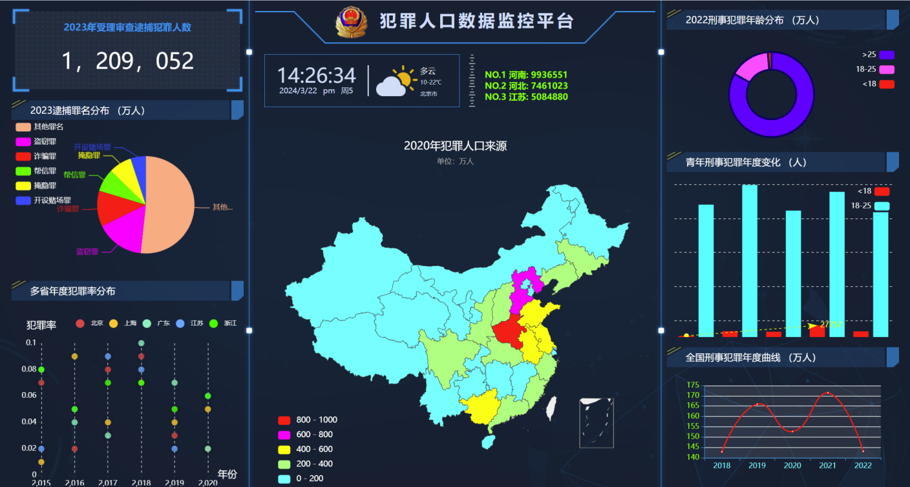
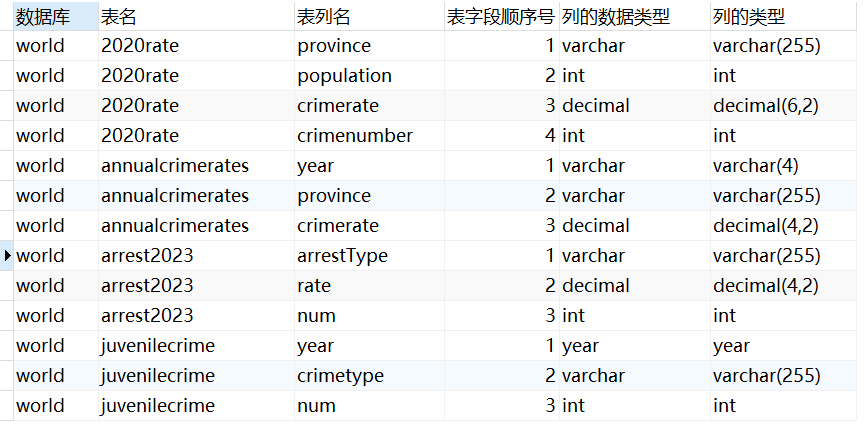

# 犯罪数据分析与可视化大屏

## 项目简介

基于 **Python + Flask + MySQL + ECharts** 构建的犯罪数据分析与可视化系统。

项目数据来源于**国家统计局**及**中华人民共和国最高人民法院**公开发布的统计数据与相关报告。通过 Python 对原始数据进行清洗、重排和格式转换后存储至 MySQL，并由 Flask 提供数据接口，前端基于 ECharts 实现犯罪人口、犯罪率、罪名分布、年龄分布及犯罪趋势等指标的可视化分析，最终形成可交互的数据分析大屏。

## 技术栈

- **数据处理：** Python、Pandas、Excel
- **后端：** Flask
- **数据库：** MySQL
- **数据可视化：** ECharts
- **前后端交互：** Ajax
- **图表类型：** 地图、饼图、环形图、柱状图、折线图、散点图

### 大屏效果



## 核心功能

系统围绕犯罪数据的**地域分布、罪名结构、年龄结构和时间趋势**进行可视化分析，并支持通过筛选条件动态查看不同年份、地区及指标的数据。

主要展示内容包括：

- **犯罪人口地域分布**：展示 2020 年全国各省犯罪人口数量及空间分布。
- **罪名分布分析**：展示 2023 年不同犯罪罪名的数量及占比。
- **各省犯罪率变化**：展示各省近六年的犯罪率变化趋势。
- **犯罪年龄分布**：展示 2022 年犯罪人员年龄结构。
- **青年犯罪趋势**：分析近五年青年刑事犯罪数量变化。
- **全国犯罪趋势**：展示全国刑事犯罪相关指标的年度变化趋势。


## 数据处理流程

```text
国家统计局 / 最高人民法院公开数据
                │
                ▼
        Python 数据清洗
                │
       ┌────────┼────────┐
       ▼        ▼        ▼
    去重      缺失值    异常值处理
                │
                ▼
        数据重排 / 格式转换
                │
                ▼
           Excel 数据
                │
                ▼
          MySQL 数据库
                │
                ▼
        Flask 数据接口
                │
                ▼
        Ajax 动态获取数据
                │
                ▼
       ECharts 可视化大屏
```

## 数据实例

项目将不同年份、地区及犯罪指标进行结构化处理，并统一存储至 MySQL，为后续统计分析和动态可视化提供数据基础。

示例数据：

| 年份 | 地区 | 指标类型 | 指标值 |
|---|---|---|---:|
| 2020 | 北京 | 犯罪人口数 | `示例数据` |
| 2020 | 上海 | 犯罪人口数 | `示例数据` |
| 2022 | 全国 | 青年犯罪人数 | `示例数据` |
| 2023 | 全国 | 犯罪率 | `示例数据` |

### MySQL 数据表


## 项目效果

项目完成了从**公开数据采集 → 数据清洗与结构化 → MySQL 持久化 → Flask 数据服务 → ECharts 动态可视化**的完整数据分析链路，将分散的犯罪统计数据转化为可交互的数据大屏，实现对犯罪地域分布、年龄结构、罪名构成及历年变化趋势的集中展示。
